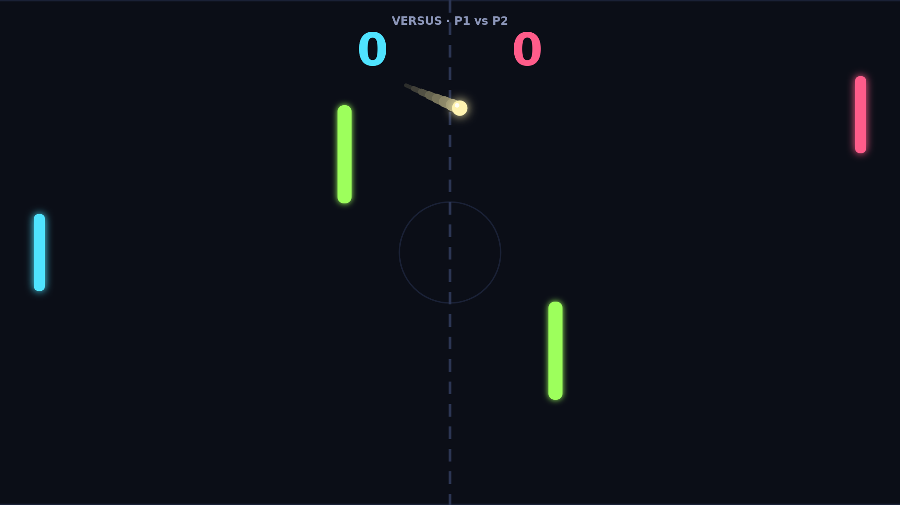
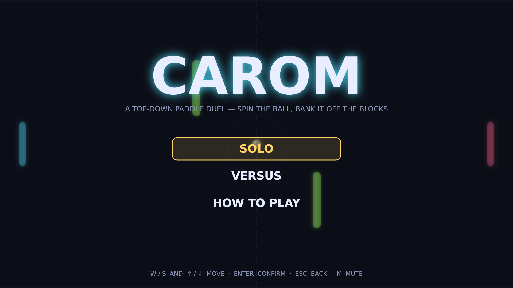

# Carom

Carom is a paddle duel played from above on a dark, glowing field. You hold one
side, your opponent holds the other, and a single bright ball ricochets between
you, off the top and bottom walls, and off two blocks standing either side of
the net. Let it slip past your paddle and the other side scores. First to
eleven, two clear, takes the match.

The opening rallies are a feeling-out. The ball leaves the center at a gentle
angle, and where it meets your paddle decides where it goes next: catch it dead
center and it flies straight back, catch it on an edge and it leaves steep.
Every return comes back a little faster, so a long rally builds toward a ball
that crosses the field in under two seconds.

Spin is where Carom opens up. Strike the ball while your paddle is moving and
the ball bends that way for the next second or so, drawing a visible curve
behind it. A late downward flick sends a shot that looks like it is heading for
the top wall and then arcs down past your opponent's paddle. The blocks make
the curve a weapon: a ball that would have hit one square can be bent around
it, or banked off it so it comes out somewhere no one was standing.

By match point the field is a bank-shot puzzle at full speed. A ball at nine
hundred units a second carries its spin through two wall bounces and a carom
off a block before it arrives, and the player who reads that path first is the
one who gets a paddle on it. Play the CPU in Solo, or share the keyboard with a
friend in Versus and settle it two points clear.

